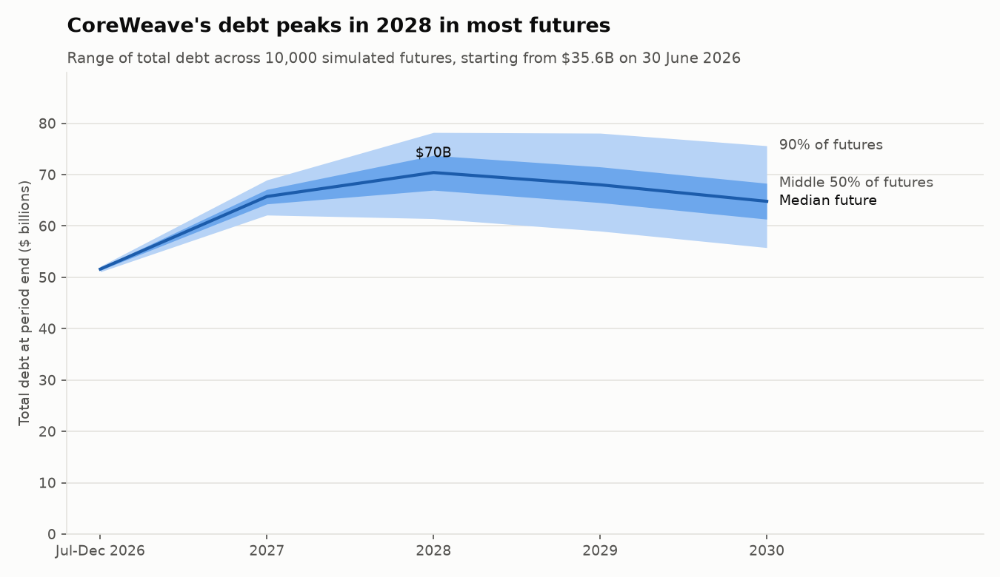
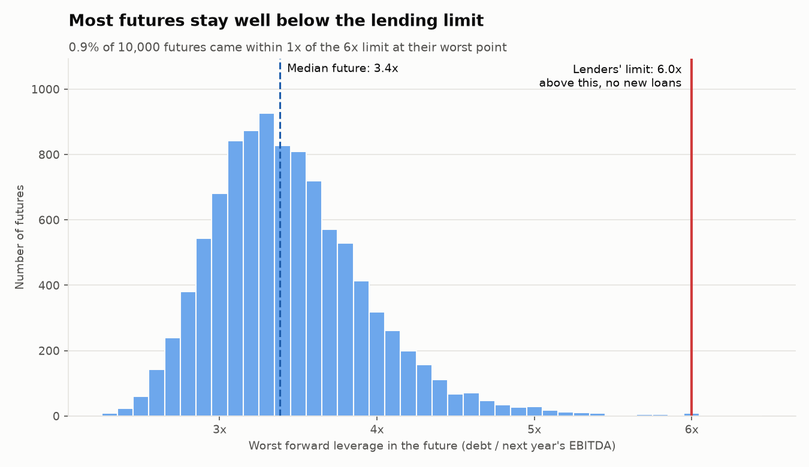
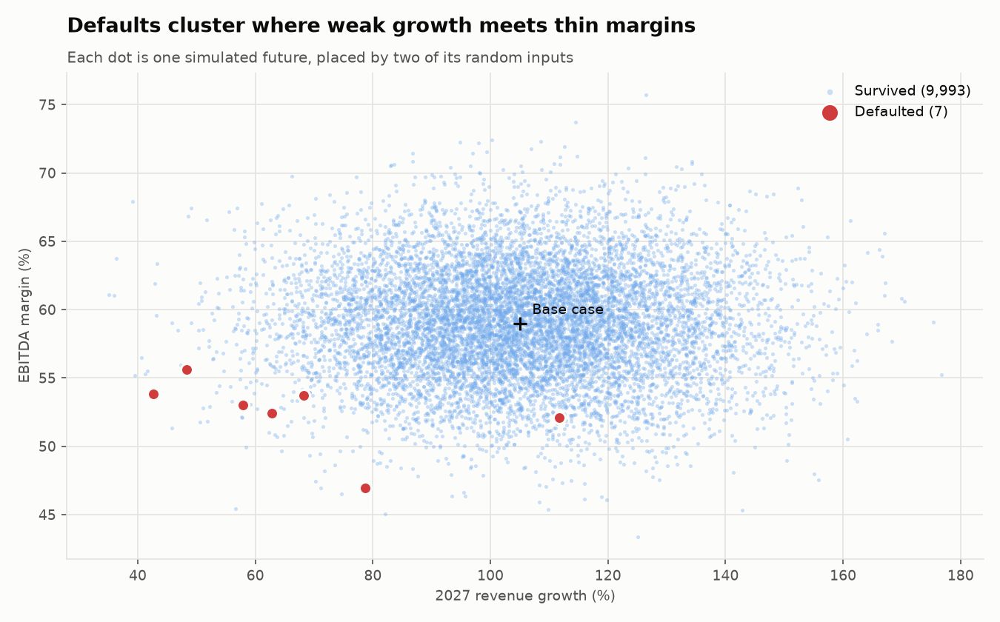
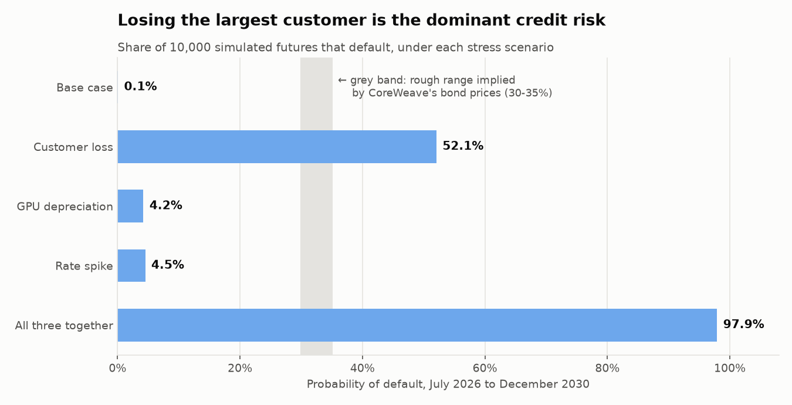

# CoreWeave: a Monte Carlo credit risk assessment

*Data as of 30 June 2026 (Q2 2026 10-Q). Model horizon: July 2026 to December 2030.*

## 1. Summary

CoreWeave rents out GPU computing capacity to AI companies. It is growing very fast (revenue roughly
doubled to $2.6B in Q2 2026) and funds that growth almost entirely with debt: **$35.6B of principal
at 30 June 2026**, up from $21.6B six months earlier.

This model asks one question: **how likely is CoreWeave to default before the end of 2030?**

- **Base case: 0.1%.** Across 10,000 simulated futures with ordinary uncertainty, CoreWeave almost
  always survives. Debt peaks around $70B in 2028, then falls as capex slows and cash flow turns positive.
- **Stress scenarios tell a different story.** Losing the largest customer pushes the probability of
  default to **52%**. Faster GPU depreciation or a refinancing rate spike alone add ~4 points each.
  All three together: **98%**.
- **Bond prices imply roughly 30-35%**, suggesting the market puts real weight on a severe shock,
  most plausibly customer concentration.

**The core credit risk is not "can CoreWeave pay its interest?" but "will lenders keep funding the
build-out?"**

## 2. Starting point (30 June 2026)

| | |
|---|---|
| Revenue, Q2 2026 | $2,575M (Q2 2025: $1,212M) |
| Adjusted EBITDA margin, Q2 2026 | 59% |
| Revenue backlog | ~$104B |
| Total debt principal | $35,551M across 16 facilities |
| Cash | $5,524M, plus $2.0B undrawn revolver |
| Floating-rate share of debt | ~34% |
| Largest customer share of revenue | 36% in Q2 2026 (71% a year earlier) |
| 2026 capex guidance | $35-39B |

Debt comes in three main forms: **delayed-draw term loans** secured on GPUs (most floating-rate,
SOFR + 2.25-4.5%), **senior bonds** at 8.5-9.75% fixed, and **convertible notes** at 1.75%. About
$4.4B matures in the rest of 2026 and $6.2B in 2027.

## 3. Method

1. **Projection.** Revenue grows from the 2026 guidance midpoint ($12.8B) to ~$26.2B in 2027
   (analyst consensus), then slows (+35%, +20%, +10%). EBITDA margin is held at 59%. Capex follows
   2026 guidance, then declines. The first period is July-December 2026, net of first-half actuals.
2. **Debt.** Existing loans are repaid on the 10-Q's contractual schedule at their effective rates.
   Any cash shortfall below a $2B minimum is filled with new debt at 9.5%.
3. **Default rules** (estimated; CoreWeave's actual covenants are not public):
   - *Liquidity default:* lenders lend only up to **6x next year's EBITDA**. If CoreWeave needs more
     than that and cash falls below zero, it cannot pay its bills.
   - *Covenant default:* EBITDA / interest falls below **1.5x**.
4. **Monte Carlo.** 10,000 futures, each with random revenue growth (2027: ±20 pts, matching the
   spread of analyst forecasts), EBITDA margin (±4 pts) and new-debt rate (±1.5 pts).
   **PD = share of futures that default.**
5. **Stress scenarios** change the base assumptions, then rerun the full Monte Carlo.

## 4. Base case

| | Jul-Dec 2026 | 2027 | 2028 | 2029 | 2030 |
|---|---|---|---|---|---|
| Revenue ($M) | 8,147 | 26,240 | 35,424 | 42,509 | 46,760 |
| EBITDA | 4,807 | 15,482 | 20,900 | 25,080 | 27,588 |
| Capex | 22,883 | 25,000 | 19,500 | 12,000 | 10,000 |
| Free cash flow | -19,572 | -14,082 | -4,568 | 6,630 | 11,341 |
| New borrowing | 20,461 | 20,266 | 8,984 | 0 | 0 |
| Closing debt | 51,599 | 65,681 | 70,249 | 67,828 | 64,607 |
| Forward leverage | 3.3x | 3.1x | 2.8x | 2.5x | 2.3x |
| Interest cover | 3.2x | 3.4x | 3.5x | 3.9x | 4.4x |

The business itself is profitable at the EBITDA level. What consumes cash is the build-out: about
$50B of further borrowing before free cash flow turns positive in 2029.

## 5. Monte Carlo results

Across 10,000 futures, debt peaks at roughly $70B in 2028 in the median case, with 90% of futures
between about $61B and $78B at the peak.

The typical future's worst point is **3.4x** forward leverage, well below the 6x lending limit;
only 0.9% come within 1x of it. **PD: 0.1%** (stable at 0.08-0.13% across random seeds).

The rare defaults combine **weak 2027 growth (below ~80%) with thin margins (below ~56%)**. Either
alone is survivable.

## 6. Stress tests

| Scenario | What changes | PD |
|---|---|---|
| Base case | - | 0.1% |
| **Customer loss** | From 2027, 30% of revenue disappears; 80¢ of EBITDA lost per $1 (leases and staff are fixed costs) | **52.1%** |
| GPU depreciation | GPUs last 4 years, not 6: each batch replaced 2 years early at 50% of original cost (+$14B capex in 2030); lending limit 5.0x | 4.2% |
| Rate spike | New debt +5 pts (to 14.5%); floating-rate loans +3 pts; lending limit 4.5x | 4.5% |
| All three together | Everything above | 97.9% |

**Customer loss dominates because of how lenders lend.** They size new loans on next year's EBITDA.
Once a 30% revenue loss is known, the 2027 forecast falls by ~40% (from $15.5B to $9.2B), so
borrowing capacity shrinks immediately, while ~$23B of GPUs ordered for the second half of 2026 still
need paying for. The median stressed future sits right at the 6x limit, and about half of the defaults happen
in late 2026, before the lost revenue has even arrived.

**GPU depreciation and rate shocks are survivable alone.** The extra GPU replacement capex lands
mostly in 2030, when CoreWeave already generates cash. Rate spikes are cushioned because about
two-thirds of the debt is fixed-rate.

**Shocks compound.** Together they make default almost certain.

## 7. Comparison with the market

CoreWeave's 2026 bonds yield about 9.5-9.75%, roughly 5.5 points above Treasuries (assuming ~4%).
A common rule of thumb:

> yearly default probability ≈ credit spread ÷ (1 − recovery rate) ≈ 5.5% ÷ 0.6 ≈ 9% a year
> → roughly **30-35% over 4.5 years**

This is far above the base case and below the customer-loss scenario. One reading: investors
price in a meaningful chance that a severe shock, especially customer concentration, actually
happens. (Spreads also include a premium for liquidity and uncertainty, so the true market-implied
PD is probably somewhat lower than this simple estimate.)

## 8. Limitations

- **No management response.** CoreWeave can't cut or delay capex, sell assets or issue shares in a
  crisis. This makes stressed PDs too high, especially for customer loss.
- **Customer contracts are multi-year take-or-pay.** In practice a large customer can't leave
  overnight; the scenario is better read as "non-renewal becomes known in 2026".
- **Independent surprises.** In reality, weak demand, higher rates and lower GPU values tend to arrive
  together, which would raise the base-case PD.
- **Estimated default rules.** Actual covenant levels are not public.
- **Simplified debt mechanics.** Annual periods; interest on new debt starts the year after it's
  borrowed; new debt isn't repaid within the horizon; operating leases ($16.3B) are excluded from
  debt.
- **The market-implied PD is a rough approximation**, not a calibrated estimate.

## Sources

- CoreWeave, Inc. [Form 10-K for FY2025](https://s205.q4cdn.com/133937190/files/doc_financials/2025/q4/CoreWeave-Inc-FY25-10-K-7.pdf) (Feb 2026)
- CoreWeave, Inc. [Form 10-Q for Q2 2026](https://www.sec.gov/Archives/edgar/data/1769628/000176962826000366/crwv-20260630.htm) (Aug 2026)
- CoreWeave results press releases: [Q4/FY2025](https://investors.coreweave.com/news/news-details/2026/CoreWeave-Reports-Strong-Fourth-Quarter-and-Fiscal-Year-2025-Results/), [Q1 2026](https://investors.coreweave.com/news/news-details/2026/CoreWeave-Reports-Strong-First-Quarter-2026-Results/default.aspx), [Q2 2026](https://investors.coreweave.com/news/news-details/2026/CoreWeave-Reports-Strong-Second-Quarter-2026-Results/default.aspx)
- 2026 guidance from the Q2 2026 earnings call, as reported by [Yahoo Finance](https://finance.yahoo.com/markets/stocks/articles/coreweave-inc-crwv-q2-2026-050033531.html) and [MarketBeat](https://www.marketbeat.com/instant-alerts/coreweave-q2-earnings-call-highlights-2026-08-11/)
- 2027 revenue consensus: [Yahoo Finance analyst estimates](https://finance.yahoo.com/quote/CRWV/analysis/), [StockAnalysis](https://stockanalysis.com/stocks/crwv/forecast/) (Oct 2026)

*This is a learning project and not investment advice.*
